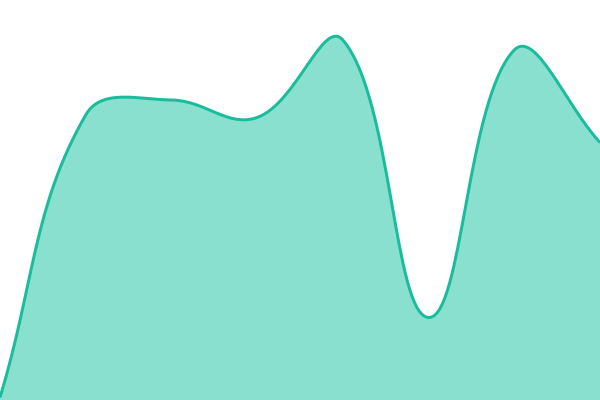
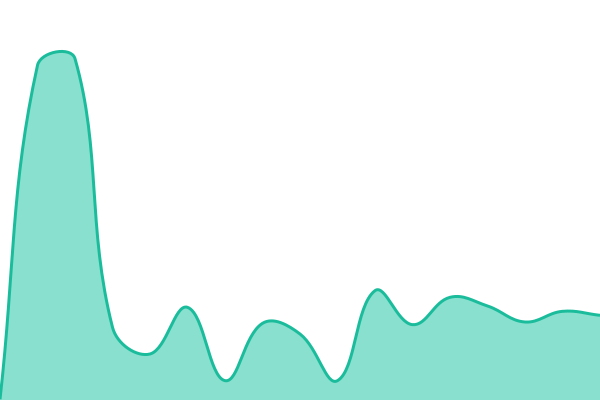

# [📈 Live Status](https://status.gausslab.io): <!--live status--> **🟩 All systems operational**

This repository contains the open-source uptime monitor and status page for [gausslab.io](https://status.gausslab.io), powered by [Upptime](https://github.com/upptime/upptime).

With [Upptime](https://upptime.js.org), you can get your own unlimited and free uptime monitor and status page, powered entirely by a GitHub repository. We use [Issues](https://github.com/albibikov/gauss-status/issues) as incident reports, [Actions](https://github.com/albibikov/gauss-status/actions) as uptime monitors, and [Pages](https://status.gausslab.io) for the status page.

<!--start: status pages-->
<!-- This summary is generated by Upptime (https://github.com/upptime/upptime) -->
<!-- Do not edit this manually, your changes will be overwritten -->
<!-- prettier-ignore -->
| URL | Status | History | Response Time | Uptime |
| --- | ------ | ------- | ------------- | ------ |
|  [Website](https://gausslab.io) | 🟩 Up | [website.yml](https://github.com/a-bibikov/gauss-status/commits/HEAD/history/website.yml) | 

 1086ms
     
 | 

<a href="https://status.gausslab.io/history/website">100.00%</a>
    

|  [Event collection](https://collect.gausslab.io/up) | 🟩 Up | [collect.yml](https://github.com/a-bibikov/gauss-status/commits/HEAD/history/collect.yml) | 

 516ms
     
 | 

<a href="https://status.gausslab.io/history/collect">100.00%</a>
    

|  [Tracker script](https://collect.gausslab.io/js/gauss.js) | 🟩 Up | [tracker.yml](https://github.com/a-bibikov/gauss-status/commits/HEAD/history/tracker.yml) | 

 499ms
     
 | 

<a href="https://status.gausslab.io/history/tracker">100.00%</a>
    

|  [API](https://api.gausslab.io/up) | 🟩 Up | [api.yml](https://github.com/a-bibikov/gauss-status/commits/HEAD/history/api.yml) | 

 512ms
     
 | 

<a href="https://status.gausslab.io/history/api">100.00%</a>
    

|  [Dashboard](https://app.gausslab.io) | 🟩 Up | [dashboard.yml](https://github.com/a-bibikov/gauss-status/commits/HEAD/history/dashboard.yml) | 

 507ms
     
 | 

<a href="https://status.gausslab.io/history/dashboard">100.00%</a>
    

<!--end: status pages-->

[**Visit our status website →**](https://status.gausslab.io)

## 📄 License

- Powered by: [Upptime](https://github.com/upptime/upptime)
- Code: [MIT](./LICENSE) © [Anand Chowdhary](https://anandchowdhary.com)
- Data in the `./history` directory: [Open Database License](https://opendatacommons.org/licenses/odbl/1-0/)
